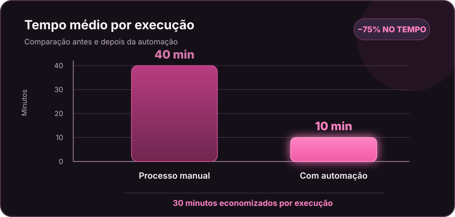

<p align="center">
  
  
</p>

<h1 align="center">Automação de Relatórios com Python</h1>

<p align="center">
  <strong>Automação desktop para padronizar rotinas recorrentes de relatórios em um ERP.</strong><br/>
  <sub>Projeto demonstrativo inspirado em um estudo de caso real, com ambiente e dados corporativos preservados.</sub>
</p>

<p align="center">
  <a href="https://1959414-5.github.io/meu-portfolio/projeto-automacao-relatorios.html">
    
  </a>
  <a href="https://github.com/1959414-5">
    
  </a>
</p>

---

## Visão geral

Este repositório apresenta uma **implementação demonstrativa e independente** de uma automação desktop para apoiar a geração recorrente de relatórios em um sistema ERP.

A solução de referência foi desenvolvida em Python para reduzir etapas manuais de navegação, preenchimento de filtros, geração de arquivos e atualização de informações em planilhas.

O projeto foi organizado conceitualmente em quatro responsabilidades:

1. **Preparação do calendário:** leitura de feriados e cálculo de datas úteis.
2. **Conferência:** apresentação dos parâmetros calculados antes da execução.
3. **Automação desktop:** interação com a interface por mouse e teclado.
4. **Controles:** mecanismos de interrupção, configuração e mensagens de execução.

> **Importante:** este repositório não contém o código-fonte proprietário utilizado no ambiente corporativo. Os exemplos publicados são independentes e didáticos. Não há credenciais, coordenadas reais, nomes de relatórios internos, dados operacionais ou configurações da empresa.

## Resultado observado no estudo de caso

O tempo médio por execução passou de **40 para 10 minutos**.

<p align="center">
  
</p>

| Ganho por execução | Resultado |
|---|---:|
| Tempo economizado | **30 minutos** |
| Redução do tempo médio | **75%** |

<sub>Comparação baseada nas médias descritas no estudo de caso. O tempo real varia conforme a quantidade de relatórios e as conferências necessárias.</sub>

## Arquitetura demonstrativa

```text
automacao-relatorios-python/
├── src/
│   └── calendario.py
├── tests/
│   └── test_calendario.py
├── data/
│   └── feriados.example.csv
├── docs/
│   ├── arquitetura.md
│   └── seguranca-e-limitacoes.md
├── .gitignore
├── requirements.txt
└── README.md
```

## Tecnologias e recursos

<p>
  
  
  
  
  
  
</p>

- **Python:** linguagem principal.
- **PyAutoGUI:** interação automatizada com mouse e teclado.
- **Pyperclip:** apoio à colagem de texto na interface.
- **Tkinter:** construção de interfaces auxiliares.
- **CSV e JSON:** armazenamento de feriados e configurações demonstrativas.
- **datetime:** cálculo e manipulação de datas.
- **threading:** organização de execução de tarefas em interface desktop.

## Exemplo demonstrativo: calendário de dias úteis

O módulo `src/calendario.py` implementa uma regra reutilizável para encontrar o dia útil anterior, desconsiderando sábados, domingos e feriados cadastrados em arquivo CSV.

### Executar localmente

Requisitos: Python 3.10 ou superior.

```bash
python -m venv .venv
```

No Windows:

```powershell
.venv\Scripts\Activate.ps1
```

Instale as dependências:

```bash
pip install -r requirements.txt
```

Execute os testes:

```bash
python -m unittest discover -s tests -v
```

## Decisões técnicas e limitações

A automação por interface é útil quando o sistema não oferece uma API ou integração adequada para a tarefa. Entretanto, exige cuidados:

- A janela do ERP precisa estar no estado esperado.
- Coordenadas e resolução de tela podem afetar a execução.
- Alterações na interface podem exigir ajustes.
- O usuário deve evitar interferência no mouse e teclado durante a rotina.
- Uma execução automatizada precisa de validação dos arquivos gerados.
- Quando disponível, uma API ou integração nativa tende a ser mais robusta que automação por coordenadas.

## Escopo público e privacidade

Este repositório apresenta uma **demonstração técnica independente**. O código operacional utilizado no ambiente corporativo não faz parte da publicação.

O material disponível foi delimitado da seguinte forma:

| Elemento | Escopo publicado |
|---|---|
| Código | Exemplo independente de cálculo de dias úteis |
| Dados | Arquivo de feriados de demonstração |
| Configurações | Parâmetros fictícios, sem coordenadas reais de interface |
| Ambiente corporativo | Sem credenciais, tokens, nomes de relatórios, caminhos internos ou dados operacionais |
| Evidências | Sem capturas proprietárias ou informações identificáveis do ambiente |

Essa separação permite apresentar a lógica e as decisões técnicas do estudo de caso sem expor sistemas, dados ou configurações internas.

Os critérios de publicação e as limitações da automação desktop estão descritos em [docs/seguranca-e-limitacoes.md](docs/seguranca-e-limitacoes.md).

## Autoria

**Bárbara Cabral Paschoalin**  
Análise de Dados · Business Intelligence · Automação

- [Portfólio](https://1959414-5.github.io/meu-portfolio/)
- [LinkedIn](https://www.linkedin.com/in/b%C3%A1rbara-paschoalin-980b52185/)
- [GitHub](https://github.com/1959414-5)

---

<p align="center">
  <sub>Automação aplicada a processos reais, com foco em eficiência, consistência e segurança.</sub>
</p>
